<p align="center">
  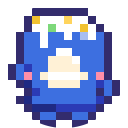
  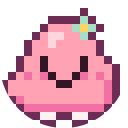
  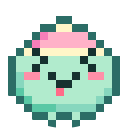
  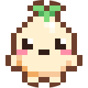
  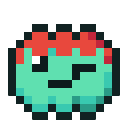
  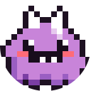
  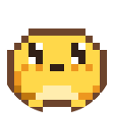
  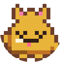
  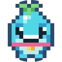
  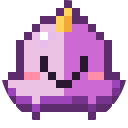
  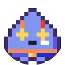
  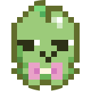
</p>

<h1 align="center">lil_guy</h1>

<p align="center">
  Deterministic pixel art avatars from any string.<br />
  ~3.8 trillion lil guys. Zero dependencies. ~32 KB gzipped.
</p>

<p align="center">
  <a href="#install">Install</a> ·
  <a href="#quick-start">Quick Start</a> ·
  <a href="#react-component">React</a> ·
  <a href="#nextjs">Next.js</a> ·
  <a href="#headless">Headless</a> ·
  <a href="#api">API</a> ·
  <a href="demo.html">Demo</a> ·
  <a href="https://isaacaudet.github.io/lil_guy/">Explore</a>
</p>

---

Pass any string — an email, username, wallet address — and get back a cute, deterministic blob character. Same input always produces the same lil guy, and every one of them is pleased to see you.

Works everywhere: React component with 3D hover + blink animation, headless SVG/PNG generation, Next.js image API route, or plain `<script>` tag.

**[Make yours →](https://isaacaudet.github.io/lil_guy/)** — type anything, get your guy, save it as a PNG with or without its name, and claim it to your wall: the word stays in your browser and is never shown, only the character it makes. Tap one drifting past, or any one you find out in the gallery, and you can take that one instead. Behind it is the gallery: an endless plane where each cell's coordinates *are* the seed, so there is no list and no edge. Order it by colour to walk the spectrum, or leave it scattered. The lattice is a spring mesh, so it stretches behind your hand and rings down when you let go.

## Install

```bash
npm install lil_guy
```

## Quick Start

### React

```tsx
import { LilGuy } from "lil_guy";

function UserAvatar({ email }: { email: string }) {
  return <LilGuy name={email} size={48} />;
}
```

### Headless (no React)

```ts
import { toSvgString } from "lil_guy";

const svg = toSvgString("alice@example.com");
// → complete SVG string, use anywhere
```

### Script tag

```html
<script src="https://unpkg.com/lil_guy/dist/lil-guy.js"></script>
<script>
  const svg = LilGuy.toSvgString("alice@example.com");
  document.getElementById("avatar").textContent = svg;
</script>
```

## React Component

The `<LilGuy>` component renders an interactive pixel art avatar with 3D tilt and blink animation.

```tsx
<LilGuy
  name="alice@example.com"
  size={64}
  shape="circle"       // "circle" | "square"
  variant="gradient"   // "gradient" | "solid" | "transparent"
  interactive          // 3D hover effect (default: true)
  enableBlink          // blink animation
  intensity3d="dramatic" // "none" | "subtle" | "medium" | "dramatic"
/>
```

### Pin specific parts

Override individual features while keeping the rest deterministic:

```tsx
<LilGuy name="alice" parts={{ hair: 2, eyes: 0 }} />
```

### Compound avatar (image with fallback)

```tsx
import { Avatar, AvatarImage, AvatarFallback } from "lil_guy";

<Avatar>
  <AvatarImage src="/photos/alice.jpg" alt="Alice" />
  <AvatarFallback name="alice@example.com" size={48} />
</Avatar>
```

## Next.js

Two-line API route that serves avatar PNGs. Caches forever since the output is deterministic.

```ts
// app/api/avatar/route.ts
import { toLilGuyHandler } from "lil_guy/next";

export const { GET } = toLilGuyHandler();
```

Then use it anywhere:

```html

```

## Headless

Generate SVG strings or PNG data URLs without React or a DOM.

```ts
import { toSvgString, toPng } from "lil_guy";

// SVG string — works in Node, Deno, Bun, browsers
const svg = toSvgString("alice", { size: 256 });

// PNG data URL — browser only (needs canvas)
const png = await toPng("alice", { size: 256 });
```

### Pipeline access

For full control, use the pipeline directly:

```ts
import { hash, resolve, compose, getPalette, resolveColor } from "lil_guy";

const config = resolve("alice");     // → { head: 5, eyes: 7, mouth: 1, ... }
const grid = compose(config);        // → 16×16 number[][] of color tokens
const palette = getPalette(config.palette);
const color = resolveColor(palette, grid[8][8]); // → "#A8F0D8"
```

## API

### `<LilGuy>` Props

| Prop | Type | Default | Description |
|------|------|---------|-------------|
| `name` | `string` | — | Input string to generate avatar from |
| `size` | `number \| string` | `40` | Size in px or CSS units |
| `shape` | `"circle" \| "square"` | `"circle"` | Avatar shape |
| `variant` | `"gradient" \| "solid" \| "transparent"` | `"transparent"` | Background style |
| `interactive` | `boolean` | `true` | Enable 3D hover effect |
| `enableBlink` | `boolean` | `false` | Enable blink animation |
| `intensity3d` | `"none" \| "subtle" \| "medium" \| "dramatic"` | `"dramatic"` | 3D rotation intensity |
| `parts` | `object` | — | Pin specific features by index |
| `palette` | `Palette` | — | Override color palette |
| `showInitial` | `boolean` | `false` | Show first letter overlay |
| `title` | `string` | — | Accessible name. Omit when the avatar sits beside the name it represents — it is then marked decorative |

The blink and the hover tilt both stop under `prefers-reduced-motion`.

### `toSvgString(input, options?)`

Returns a complete SVG string. No DOM or React needed. Horizontal runs of one
colour are merged into a single `<rect>`, which is roughly a third the size of
one rect per pixel.

Pass `title` to give the SVG an accessible name; without it the SVG is marked
decorative (`aria-hidden`), which is what you want beside a visible username.

At 36px and under it draws for a small size (`small`): each eye solid, dark ink
darker, the soft highlight back to the body colour, and a square avatar cropped
to the guy so it fills it. Pass `small: false` to keep the full drawing.

### `toPng(input, options?)`

Returns a PNG data URL. Browser only.

### `toLilGuyHandler(options?)`

Creates a Next.js route handler. Returns `{ GET }`.

## Animations

Thirteen moves for games: `idle`, `blink`, `hop`, `wave`, `look`, `cheer`, `sad`,
`dance`, `squish`, `sleep`, and three anime reactions, `shy`, `huff` and `oops`. They take the same options as `toSvgString`, so a guy
hops in the hat it is wearing.

```ts
import { toAnimatedSvg, animate, frameAt, drawFrame } from "lil_guy";

// One self-contained SVG that plays by itself: inline it or use it as an .
el.innerHTML = toAnimatedSvg("alice", "cheer", { game: "puttsies", size: 96 });

// Or draw the frames yourself, in a canvas game loop.
const hop = animate("alice", "hop", { equip: [savedCopy] });
drawFrame(ctx, frameAt(hop, elapsedMs), x, y, 4);
```

A guy changes face for some of them: a laugh to cheer and dance, a wobbly
mouth when sad, an "ooh" when squished. Its own eyes always stay. Little
emotes pop up beside it (music notes, a question mark, a heart, a "!"), and
dust puffs out when it lands.

The anime reactions are manga's own symbols on the guy's own face. `shy`: a
manga blush (pink hatched with red, ////) comes up, he looks away and a little
heart floats up beside him. `huff`: hmph, eyes shut, a pout, his back turned,
the cross-shaped anger vein throbbing over his head and one stamp. `oops`:
tehe, eyes shut, the tip of his tongue out and a sweat drop running down his
temple. `sad` runs the same sweat drop down his temple, and `squish` ends
with one, phew.

Players can show an emote over any move with `emote`. `EMOTE_UNLOCKS` lists
them and how each is earned: a heart, music, a snooze, "huh?", "whoa!", a
little floating heart, a sweat drop and an anger vein for everyone, a flame
for a 7-day streak and a crown for a perfect day.

Each guy keeps his own time. His `idle` is dealt from his name like his parts:
three to five breaths a loop (or a little lift, for a floater), where in the
loop he starts, and a few habits between breaths (a blink or a double blink, a
glance, a smile, a content shut-eyed smile, an "ooh", a blep, a hop). The same
guy always idles the same way, and two guys side by side are never in step.
His blink, dance and sleep keep tempos of their own too.

Frames are 16 wide and 20 tall: the guy stands in the bottom 16 rows exactly
as in the still, and the top 4 are room to jump into. Every frame is made from
the guy's own pixels. A squash loses a row of the body between his mouth and
his feet and a stretch repeats one, never a row of his eyes or mouth; with no
room there it takes one above his eyes, and with none at all he bobs instead
(`squashRows` says what it does for a guy). A blink or a glance moves the eye
pixels. Nothing is scaled.

Sparkles (a rare copy's, a Gold finish's mark, a Lucky guy's, a cheer's
stars, a rare aura's) are all one glint: a dot that brightens, opens into a
small cross, turns to a diagonal glint and goes out, near the guy, one at a
time, on its copy's own clock.

Rarity shows in the frames, so it reads without a shader. The best copy it is
wearing sets how much:

| Grade | In the frames |
|---|---|
| Everyday | nothing extra |
| Special | a shine sweeps across the item |
| Prized | and a ring in the grade's colour pulses round the guy |
| Mythic | and sparkles, and a trail when it jumps |
| ★ Grail | a gold ring, more sparkles and a gold trail |
| ★ Aura | the aura itself, moving, in place of the ring |

**In React**, `<LilGuyAnimated name={seed} move="cheer" equip={[copy]} />` plays a
move with the same SVG, so no timer runs in React.

**With the finishes moving.** The frames carry a per-pixel mask of which item
each pixel belongs to (`frame.slots`), so a shader can run each copy's finish
on its own pixels. `createShine()` is that shader: one WebGL context to share
across a page or a game. Draw a guy's frame into it, then copy the 16×20
result into its canvas with `drawImage`. It returns null without WebGL; draw
the frame's colours as they are.

**Size.** The package is free of side effects, so a bundler keeps only what's
used: still faces alone are about 17 KB gzipped, with animation about 20 KB,
and everything (items, copies, share cards, the shader) about 27 KB.

`rarity: false` turns it off. `once: true` plays the SVG once and holds the
last frame. The SVG plays whatever the reduced-motion setting is, as the DLE
Club games do; pass `stillWhenReduced: true` to hold the first frame instead.

## Finished guys anywhere

Every guy can be delivered finished: its move, aura, effects, emotes and its
copies' finishes all baked into frames, the same pixels everywhere. One
renderer does it, in plain code (`bakeGuy`, `bakeCard`, `bakeView`), so a
server, a page and a game all get the same picture.

A card is a trading card. Its window shimmers in its copy's finish's own foil
(Sunset stripes, a Tempered oil slick, a Nebula cosmos, Prism cracked ice, a Gold
sunburst), with the print picking one of four variants. An item's card carries
its machine's set symbol. A Grail card is brushed gold foil with a glint
sweeping it, a bevelled edge and gold studs round a deep amber window; an aura
card is pale silk in the aura's own colour with a double foil edge, its deep
window glowing in that colour behind the guy.

A finish repaints a copy's own colours through the finish's ramp by tone, so
every part keeps its shading and stays apart from the next: Prism a smooth
rainbow sweep, Tempered steel-blue and straw-gold bands, Nebula deep purple
clouds with a few pulsing stars, Negative the item's opposite colours with
light and dark swapped, Gold polished gold with a moving glint. A costume's
face opening keeps the guy's own colours, and a hat drawn partly in them (cat
ears) takes the finish there too.
On lilguys.dleclub.com each copy also keeps stats, as a sports card does:
days worn and, while worn, DLE Club games finished and the best club day.
Each copy also has its place in its item's run: the first 100 are 1st editions.
`CardInput.footer` puts the set number and 1st edition, and the machine's set symbol, at a card's
foot; the stats show in the site's inspect view, not on the card.

```html
<!-- Any page: the picture from the lil guys Worker, no library on the page (1.7 KB gzipped). -->
<script src="https://lilguys.dleclub.com/lil-guy-element.js"></script>
<lil-guy name="mia" size="3"></lil-guy>              <!-- a claimed guy, as it's worn -->
<lil-guy seed="Sneaky Gumdrop" view="hop"></lil-guy> <!-- any text's guy, hopping -->
<lil-guy name="mia" view="card" size="4"></lil-guy>  <!-- its card, shimmering -->
```

Or the addresses themselves, `/g/<art version>/<guy>/<view>`:

| | |
| --- | --- |
| `<guy>` | a guy code (`guyCode({ seed, parts, palette, equip })`) or `@name` for a claimed name |
| `idle.png`, `hop.png`… | the move looping, an animated PNG (plays in a plain ``) |
| `still.png` | its first frame, for dense lists |
| `card.png`, `card-still.png` | its card, its shimmer looping |
| `pfp.png`, `pfp-still.png` | a profile picture: square, on a ground of its own colour, with room so a round crop never cuts it (`pfp-still@16.png` is about Discord's 512 px) |
| `idle.sheet.png` + `idle.sheet.json` | the frames in a strip and their times, for a game's sprite |
| `idle@4.png` | any of these scaled up by whole pixels (1 to 16) |

A code's images never change for an art version (`ART_VERSION`), so they are
cached for good; a redraw bumps the version and every board shows it at once.
`@name` redirects to the guy's code, so it follows what it wears. Show them at
whole-number sizes with `image-rendering: pixelated`.

With the library on the page, `LilGuy.defineLilGuy()` makes `<lil-guy>` bake
in the page instead (set `.spec` or `code`); `defineLilGuy({ host })` uses the
Worker. The lil guys site bakes in the page, and `scripts/verify-site.mjs`
checks every card and guy it shows against the Worker's frames.

For a game that draws with WebGL, `SHINE_FRAGMENT`, `CARD_FRAGMENT`,
`createShine` and `createCardShader` run the same effects on the GPU; every
movement repeats in `LOOP_MS` and noise is precomputed per pixel, so
`scripts/verify-shaders.mjs` finds the GPU and the plain code within one step
of 255 on every pixel. Pointer effects (tilt, a hover light) aren't baked: they
are the page's, on top.

## How It Works

1. **Hash** — FNV-1a hash of the input string, with an independent hash for each slot, so adding a part to one slot never reshuffles the others
2. **Resolve** — Each hash picks a body shape, eyes, mouth, cheeks, topper, marking, accessory, arms, feet, colourway and tone. Picks are weighted (`src/parts/weights.ts`) so the simplest, sweetest looks are the common ones and the busy ones are a treat to find
3. **Compose** — The parts are layered onto a 16×16 grid of colour *roles* (body, shade, blush, accent, …). Every shape is lit the same way — a gleam on the upper left, a soft shade along the bottom — and then the whole guy, hat and arms included, gets an outline. Parts measure the head they land on: hats hug its top rows, ears sit on its shoulders, the face follows its eye line
4. **Render** — Each colourway is three hand-picked colours (body, accent, trim). The outline, shade, gleam, eyes and blush are worked out from the body, so they always belong to it — the outline is a deep version of the body colour rather than black, and the blush is always a pink that shows

### The art

Every part is drawn by hand, as text, one character per pixel, so the
library can be read and edited like a picture:

```ts
pair('cat ears', [
  '#..',
  '#c.',   // # body, c blush
  '###',
]),
```

A few rules keep every combination good-looking:

- **Charm first, with some edge.** Most guys have shiny eyes set wide apart and a small pleased mouth; some are chill, side-eyed or squinting, smirk, grit their teeth or chew gum, wear a scar or war paint, a mohawk or headphones, or come in a night colourway. Shades, star eyes and laser eyes are the rare finds
- **Every solid eye has a catchlight.** A flat dark square with no shine is what reads as dead-eyed
- **Clean colours, with depth.** No greys or murky browns; every guy gets the same outline, gleam and shading, and the vivid tone is common
- **Nothing is clipped.** Tests check every shape against every hat, accessory, arm pose and foot style: each guy is fully outlined inside the frame, in one piece, and no hat or scarf ever covers an eye or the mouth

25 shapes × 17 eyes × 16 mouths × 14 cheeks × 30 toppers × 14 markings × 14 accessories × 3 arm poses × 5 foot styles × 38 colourways × 3 tones × 2 (mirrored) × 2 (Lucky or not) = **3,828,867,840,000** characters. Weighting makes the simple parts common and the loud ones rare, so the set behaves like about 294 billion equally-likely guys.

**Lucky.** About one name in 400 (`LUCKY_ODDS`) comes out Lucky: the same colourway turned round the colour wheel, with gold trim. It counts in `guyOneIn` like any trait.

### Pinning parts

Every slot can be pinned through `parts`, and the rest stays deterministic:

| Slot | Values |
|---|---|
| `head` | `0-31` body shape: round, mochi, egg, gumdrop, onigiri, ghost, slime, loaf, cloud, pill, chonk, block, tower, gourd, flame, jellyfish, octopus, robot, cactus, saucer, shard, toadstool, bat, crab, heart, dumpling, tooth, star, acorn, gem, clover, disco; chase: gem, clover, disco |
| `eyes` | `0-26` beans, shiny, happy, sparkle, wink, glossy, excited, hearts, lashes, chill, side-eye, shades, star, squint, fired up, laser, cyclops, sleepy, dizzy, anime, galaxy, diamond, dragon, shoujo, kitty, joy, puppy; chase: galaxy, diamond, dragon; capsules only: shoujo, kitty, joy, puppy |
| `mouth` | `0-24` smile, cat, laugh, beak, blep, grin, fang, smirk, ooh, tiny, wobble, toothy, tongue out, flat, gritted, bubblegum, bunny, vampire, wide, gold tooth, grillz, mustache, kissy, yay, tehe; chase: gold tooth, grillz, mustache; capsules only: kissy, yay, tehe |
| `cheeks` | `0-19` bare, blush, dot, rosy, freckles, scar, band-aid, war paint, whiskers, hearts, shine, stripes, stars, gold leaf, flushed, shy, mole, jewels, rainbow, manga blush; chase: jewels, rainbow; capsules only: manga blush |
| `hair` | `0-36` toppers: none, cat ears, bear ears, bunny ears, bug antennae, horns, space buns, sprout, apple stem, flower, bow, crown, party hat, antenna, unicorn horn, star clip, tuft, chick tuft, beanie, cap, bob, mushroom, eggshell, frosting, leafy top, beret, witch hat, propeller, mohawk, headphones, cherries, flower crown, antlers, chef hat, laurel, star crown, on fire; chase: laurel, star crown, on fire |
| `body` | `0-18` markings: plain, belly, two tone, tabby, spots, star mark, heart mark, gleam, stripes, zigzag, split, moon mark, bolt mark, starry, polka dots, blaze, sprinkles, kintsugi, gold dipped; chase: kintsugi, gold dipped |
| `accessory` | `0-19` none, glasses, scarf, bell collar, bowtie, bandana, star sticker, heart badge, monocle, eye patch, necklace, medal, flower pin, headband, necktie, lei, goggles, gold chain, heart shades, masquerade; chase: gold chain, heart shades, masquerade |
| `arms` | `0-2` none, by the sides, waving |
| `feet` | `0-4` nubs, tiptoes, wide, socks, tucked |
| `shade` | `0-2` pastel, as picked, vivid |
| `flip` | `boolean` mirrors the finished guy |
| `lucky` | `boolean` the Lucky colour variant |

```tsx
<LilGuy name="alice" parts={{ hair: 1, arms: 2, flip: true }} />
```

The parts are exported (`heads`, `eyes`, `mouths`, `cheeks`, `hair`, `bodies`, `accessories`), each with a `name`, so you can list or label them.

**The deal.** A seed from `makeSeed()` starts `3-` and is dealt from today's
weights: a few simple, good-looking parts carry most guys, busier ones are
uncommon, and the chase parts above turn up one guy in 300 to 1,000. Anything
else (an older seed, a plain name) is dealt from `DEAL_2`, a frozen copy of the
weights before deal 3, so adding parts never redraws a guy already dealt.
`traitOdds(config)` gives each part's odds.

**The anime set** is never dealt: shoujo eyes (big and glossy, two catchlights,
the iris glistening as he moves), kitty eyes (gold, a slit pupil), joy eyes
(^ ^), puppy eyes, a kissy 3, a yay ▽, a tehe tongue and the manga blush. Each
weighs 0 in every deal, so no guy already dealt changes, and is listed in
`CAPSULE_ONLY` with its weight for capsules: a capsule unlocks one like any
rare part, and metal crafts it.

## Game items

Every DLE Club game has things a player can wear, here and in every other game,
and so does the club's own Pet shop (cats, dogs, foxes and bunnies). The guy
underneath — face, shape, colours — never changes, so a player is
recognisable everywhere.

| Game | Skins | Showpiece | Hats (first is free) | Frames | Buddies |
|---|---|---|---|---|---|
| Amountle | Jar of gems, Crystal, Gumball machine, Jellybean | Today’s jar | Gem band, Winners crown, Jar lid, Gumball globe, Wrapped sweet | Jelly beans, Jar glass, Shelf | Gemling, Gummy bear, Lil jar, Candy corn |
| Halfsies | Avocado half, Peach, Burger suit, Trophy half | Banana split | Chef’s hat, Gold star, Split beanie, Thirds cake, Pancake stack | Kitchen teal, Half and half, Dashed cut line | Half-shell chick, Avo, Lil acorn, Cake slice |
| Stackdle | Wedge, Keystone, Arch, Big L | Astronaut | Little block, Block tower, Battlement, Hard hat, Cloud nine | Valley sky, Height ruler, Space | Cubelet, Wobble, Lil yeti, Lil star |
| Flipsies | Water bottle, Pencil, Duck onesie, Buttered toast | Moai | Bucket hat, Short stack, Fried egg, Popcorn bucket, Lampshade | Ring mat, Cork coaster, Book spines | Goldfish, Ketchup, Rubber duckling, Toaster |
| Puttsies | Golf ball, Quilt pillow, Golfer, Eight ball hoodie | Engine driver | Golf cap, Hole-in-one crown, Magic top hat, Sleeping cat, Snail | Patchwork, Picnic check, Dimples | Gopher, Sprinkles, Wind-up mouse, Toy blocks |
| Weighsies | Kettlebell, Panda onesie, Penguin onesie, Capybara | T. rex onesie | Bear ears, Apple shot, Sumo topknot, Pharaoh, Liberty crown | Lavender, Pennies, Gold bars | House cat, Lil whale, Hamster, Pigeon |
| Cutsies | Kiwi hoodie, Strawberry hoodie, Donut floatie, Salmon nigiri | Watermelon suit | Chef’s headband, Chef's toque, Toadstool, Peeled banana, Cupcake | Melon slice, Chopping board, Slice line-up | Pear, Tomato, Corn cob, Eggplant |
| Tiltsies | Hamster ball, Biscuit hoodie, Mochi hoodie, Starfall pyjamas | Golden seed | Hamster ears, Head hamster, Mochi’s bow, Pebble’s sprout, Daisy crown | Course tiles, Cloudy sky, Seed trail | Pocket hamster, Ladybug, Springy, Ghost |
| Trackdle | Cone suit, Pit crew, Snow parka, Dune rider | Formula 07 | Pit cap, Cowboy hat, Boost flame, Bobble hat, Chequered bandana | Canyon sunset, Kerb, Boost pad | Conelet, Tyre stack, Lil racer, Saguaro |
| Pet shop | Cat onesie, Shiba onesie, Bunny hoodie, Frog hoodie | Kitsune | Cat ears, Head puppy, Fox ears, Bunny ears, Cat-ear headphones | Paw prints, Cozy cushion, Sakura | Kitten, Puppy, Axolotl, Bunny |

Items a machine no longer gives stay in `src/sets/<game>.ts` as `retire`: copies already owned keep drawing, capsules and crafting skip them.

A **skin** turns the guy into the game's object and keeps its face. Each machine also holds one **showpiece** (`showpiece: true`): a whole new character (a moai, a toy train, Formula 07…), coming out at half an ordinary item's weight (`SHOWPIECE_WEIGHT`), every copy moving with its own effect (`signature`), which is neither in its name nor its odds.

Every capsule also unlocks a **part** the player doesn't have yet (`rollPart`, any slot, head and colours included), rarer ones less often; metal crafts a chosen one (`partCost`). Pass a player's earned parts (`unlocksOf(codes)`) to `pickable`, `allowed`, `decodeLook` and `lookOf` and they can pick it; a guy's rarity stays the deal's.

**Crafting, as in TF2** (`src/craft.ts`, `src/paints.ts`): a copy smelts into metal (`smeltValue`, in scrap: three scrap a reclaimed, three reclaimed a refined, written `2.44 ref` by `metalText`), a refined crafts the exact item you want (`craftCopy`, Plain, with a craft number), and a reclaimed paints a hat or a buddy (`paint` on the copy, twelve paints from A Lack of Hue to Pink as Heck, keeping the item's light and shade). A copy with a tally is a Strange one.

**Buddies.** Each game has four buddies, tiny pets that sit at the guy's
feet, bottom right, in front of everything, with their own outline. Equip one
like any item.

**Seasonal hats.** Club birthday (12 October – 16 October), Pumpkin (20 October – 2 November), Snow cap (15 December – 6 January), Sweetheart (10 February – 16 February), New Year top hat (29 December – 2 January), Red lantern (20 January – 12 February), Shamrock (10 March – 18 March), Cherry blossom (19 March – 14 April), Painted egg (22 March – 25 April), Daisy chain (1 May – 31 May), Sun hat (14 June – 20 July), Fireworks (1 July – 7 July), Ice cream (1 August – 25 August), Maple leaf (20 September – 30 November), Turkey feathers (18 November – 30 November), Reindeer antlers (1 December – 24 December)
only drop in their days: `inSeason(day)` lists what's dropping and
`rollSeason(seed, day)` rolls one. A seasonal copy keeps its day (`~d2026-10-31`
in its code) and its year in its name, so a 2026 Pumpkin is its own thing.

**Share cards.** `toShareSvg(seed, copy, { name })` draws a 1200×630 card of the
guy wearing a copy, with its grade, condition, tally and odds: one SVG with
nothing to fetch, ready to turn into a link preview.

### Owned copies: finish, scuff, print, tally

An item is a design. A copy someone owns is the item plus:

| | |
|---|---|
| **Finish** | Plain (79.87%), Sunset (15.98%), Tempered (1.6%), Nebula (1.6%), Prism (0.5%), Gold (0.25%), Negative (0.2%). Everything but Plain and Tempered only comes Box Fresh or Like New |
| **Scuff** | 0–1, how worn it is. Box Fresh < 0.07 < Like New < 0.15 < Played With < 0.38 < Well Loved < 0.45 < Battered. The wear really shows: paint chips off as it rises, and a Box Fresh copy keeps a glint |
| **Print** | 0–999, where the finish lands, and where the chips go. A few are famous: Tempered comes in five tints the print picks (Steel, Rose, Emerald, Copper, Violet), and prints 661, 670, 321, 387 and 955 come out all blue (Deep Blue); a Nebula's print picks its look, and Red Giant, Blue Moon and Black Hole are the rare ones |
| **Tally** | on 1 drop in 10: a counter of the days its owner finished the game while wearing it. It only goes up, and stays with the copy. It shows: two marks scratched into the item at 30 days, four at 100, and at 365 its outline turns gold |
| **Souvenir** | the day's free capsule for finishing every game is a souvenir of that day (`~s2026-10-25` in its code). No other capsule is one |
| **Pins** | up to three, earned and stuck on: a gold star (a perfect day), a flame (a 7-day streak), a heart (100 days played), a bolt (fastest of the day), a crown (top of a board) and a leaf (a first week). The club grants them; they are drawn on the item's own pixels |

Grades follow from the finish: Everyday, Special, Prized, Mythic (a famous
print lifts a copy one grade), ★ Grail (Gold, with a sparkle), and above them
★ Aura.

`collectorNotes(copy)` names what makes one copy the one people want: a 0.000
or 0.00 float, max float, the best of a condition just over its line, a famous
print, print #1 or #0, lucky, triple and straight print numbers, a souvenir, a
tally and pins, each with about how many copies have it.

### ★ Auras

One capsule in a thousand (`AURA_ODDS`), from any machine, is an aura instead
of the machine's item: an effect drawn in the empty pixels round the guy, never
over it, that moves with it. There are twenty-four (`AURAS`): flames, orbit,
halo, sparkles, hearts, bubbles, rain cloud, lightning, music, snowfall,
petals, galaxy, rainbow, glitch, fireflies, neon, echo, comet, butterflies,
aurora, data rain, vortex, fireworks and ripple, and Origin, the founder's,
which no capsule gives (`ONE_OF_ONE_AURAS`). The list is append only: copies
store an aura by id. An aura copy has its own finish: Classic (50%),
Fade (22%), Frost (12%), Toxic (8%), Shadow (5%) and Deep sea Sapphire (1.5%),
Ruby (1.2%) and Black pearl (0.3%). Its float shows (a battered aura flickers
with gaps) and its print sets its timing. Neon is one tube in one colour a
copy (its finish's, or one its print deals for Classic, Fade and Black pearl)
that hums and now and then flickers. Wear one like any item
(`equip: ['aura.flames~ruby~0.0123~7']`); still pictures draw it at a still
moment, `animate` moves it.

**Everyone gets one.** `starter(name, game)` is the copy of a game's free hat
every player has from the start: plain, with a scuff and print taken from
their name, so everyone's is a little different and a lucky name gets a
Box Fresh. `roll(seed, game)` opens a capsule. The seed decides everything,
so in production it must be made on the server at drop time and stored with
the copy.

A copy is one short string, to store or put in a URL:

```ts
import { roll, encode, decode, nameOf, wearOf, gradeOf } from "lil_guy";

const copy = roll(serverSeed, "puttsies");
const saved = encode(copy);          // "puttsies.ball~nebula~0.0123456~20"
encode({ ...copy, tally: 412, pins: ["star", "flame"] });
                                     // "…~20~t412~pstar+flame"
nameOf(copy);                        // "Golf ball | Red Giant"
wearOf(copy.scuff).name;             // "Box Fresh"
gradeOf(copy).name;                  // "Mythic"

toSvgString("alice", { game: "puttsies" });         // wears her own free visor
toSvgString("alice", { equip: [saved] });           // wears this exact copy
```

### How rare is it

`guyOneIn(config)` is one in how many guys has exactly that combination of
traits; `traitOdds(config)` lists each trait's chance, always the same twelve in
the same order (`TRAIT_SLOTS`): shape, eyes, mouth, cheeks, topper, markings,
accessory, colour, tone, arms, feet and lucky. `TRAIT_ICONS[slot]` is a small
pixel icon for each, and `TIER_ICONS` one for each tier a page shows (Common,
Uncommon, Rare, Legendary, Chase): SVG strings in `currentColor` with a
`viewBox` and no size, so CSS sizes and colours them. `copyOneIn(copy)`
is one in how many capsules give a copy at least that good: its item, finish,
a famous print if it has one, a scuff at least that low, and a tally.

| Copy | One in |
|---|---|
| A plain drop, Played With | ~20 |
| Sunset, Box Fresh | ~250 |
| Gold, Box Fresh | ~1,500 |
| Nebula Red Giant / Blue Moon / Black Hole | ~12,500–25,000 |
| Tempered Deep Blue | ~1 million |
| Strange Deep Blue at 0.002 | ~300 million |

`equip` takes item ids or encoded copies. This library only draws them and
rolls them; who owns which, and what it costs, belongs to the game or the club.

### Keeping rarity real

A rare guy only means something if nobody can choose one. So:

- **Draw from a seed, not the name on the board.** Names can be typed, tried
  and changed. Make a seed once with `makeSeed()`, keep it with the player and
  draw from it (`toSvgString(seed)`, `starter(seed, game)`). The name stays a
  label, a rename changes nothing, and nobody can search for a rare guy.
- **A picker offers only common parts, plus the player's own.**
  `pickable(own, slot)` lists them and `allowed(own, look)` checks a choice.
- **Save picked looks as versioned codes.** `encodeLook({ eyes: 1 })` gives
  `2:e1`; `decodeLook` refuses old seven-number codes, out-of-range parts and
  rare parts the player didn't roll, and `lookOf(seed, code)` draws the
  result.

### Upgrading from 0.1

0.2 is a redraw: every name maps to a new character. The API is the same
apart from the config shape — `AvatarConfig` gained `cheeks` and `arms`,
dropped `patternTone`, and colour tokens now run 0–18 instead of 0–8. If you
store pinned `parts`, re-pick them against the new library.

## License

MIT
